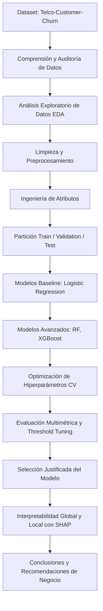

# Predicción de Churn en Clientes de Telecomunicaciones: Contexto y Formulación del Proyecto

## 1. Contexto del Problema
Una empresa de telecomunicaciones desea anticiparse al abandono de sus clientes (*churn*). Para ello, busca desarrollar un modelo de Machine Learning capaz de identificar perfiles con alta probabilidad de rescisión o no renovación de servicios, permitiendo implementar estrategias de retención proactivas y focalizadas antes de que se concrete la pérdida.

El abandono de clientes representa uno de los desafíos más críticos y costosos en la industria de telecomunicaciones, dado que el costo de adquisición de un nuevo cliente suele superar significativamente el costo de fidelizar y retener a un cliente existente. Una identificación temprana y confiable de aquellos clientes en riesgo permite optimizar el presupuesto comercial, orientando las campañas y beneficios a los segmentos de mayor vulnerabilidad.

Para el desarrollo del proyecto se utilizará el dataset histórico **Telco Customer Churn**, el cual reúne información sobre 7.043 clientes con 21 variables que describen:
- **Datos demográficos:** Género, tercera edad (*SeniorCitizen*), pareja y dependientes.
- **Servicios contratados:** Telefonía, múltiples líneas, internet (DSL, Fibra óptica, Sin servicio), seguridad online, respaldo online, protección de dispositivos, soporte técnico, streaming de TV y películas.
- **Información de la cuenta y contrato:** Tipo de contrato (mes a mes, un año, dos años), facturación electrónica (*PaperlessBilling*), método de pago y antigüedad del cliente (*tenure* en meses).
- **Aspectos financieros:** Cargos mensuales (*MonthlyCharges*) y cargos totales acumulados (*TotalCharges*).

---

## 2. Tipo de Problema
- **Naturaleza analítica:** Tarea de aprendizaje supervisado de **clasificación binaria**.
- **Enfoque predictivo:** Más allá de una clasificación rígida (0 o 1), el modelo debe estimar la **probabilidad calibrada** ($P(\text{Churn}=1)$) de que un cliente abandone el servicio, permitiendo priorizar y segmentar según nivel de riesgo.

### Variable Objetivo

| Variable | Descripción | Tipo Original | Codificación en Modelo |
| :--- | :--- | :--- | :--- |
| **`Churn`** | Indica si el cliente abandonó el servicio | Categórica binaria (`"Yes"`, `"No"`) | **`0`**: Continúa activo (`"No"`)<br>**`1`**: Abandonó el servicio (`"Yes"`) |

*Distribución en el dataset:*
- `No` (0): 5.174 clientes (~73,46%)
- `Yes` (1): 1.869 clientes (~26,54%)  
*(Existe un desbalance moderado de clases que deberá ser contemplado en el preprocesamiento y la selección de métricas).*

---

## 3. Objetivos del Proyecto

### 3.1. Objetivo General
Desarrollar, evaluar y justificar un modelo de Machine Learning capaz de estimar la probabilidad de abandono de clientes en una compañía de telecomunicaciones a partir de su historial contractual, conductual y financiero, facilitando la detección temprana de perfiles en riesgo y respaldando la toma de decisiones comerciales de retención.

### 3.2. Objetivos Específicos
1. **Exploración y comprensión de datos (EDA):** Examinar la estructura del dataset, distribuciones, correlaciones, valores atípicos y resolver inconsistencias (como registros con espacios en blanco en cargos totales).
2. **Análisis de factores determinantes de Churn:** Contrastar visual y estadísticamente las relaciones entre los atributos de los clientes (antigüedad, tipo de contrato, servicios) y la tasa de abandono.
3. **Preprocesamiento y limpieza de datos:** Imputar datos faltantes, eliminar identificadores irrelevantes (`customerID`), aplicar codificación adecuada de variables categóricas (*One-Hot / Ordinal Encoding*) y escalar características numéricas cuando el algoritmo lo requiera.
4. **Ingeniería de atributos (*Feature Engineering*):** Diseñar nuevas variables derivadas (ej. cantidad de servicios agregados, ratio de cargos, cohortes de antigüedad) que aporten señal predictiva al modelo.
5. **Entrenamiento de modelos:** Establecer un modelo de referencia (*baseline*, ej. Regresión Logística) y comparar iterativamente contra algoritmos basados en árboles y ensambles (*Decision Tree*, *Random Forest*, *XGBoost*).
6. **Optimización de hiperparámetros:** Realizar ajustes sistemáticos mediante validación cruzada estratificada (*Stratified K-Fold*) y técnicas de búsqueda como `GridSearchCV` o `RandomizedSearchCV`.
7. **Evaluación multidimensional y de negocio:** Evaluar el rendimiento utilizando métricas robustas frente a desbalance (ROC-AUC, PR-AUC, Recall, Precision, F1-Score) y analizar el impacto de variar el umbral de decisión (*threshold tuning*).
8. **Selección fundamentada del modelo:** Seleccionar el modelo final integrando el rendimiento estadístico, la estabilidad, el costo computacional y la utilidad para el negocio.
9. **Explicabilidad e interpretabilidad con SHAP:** Aplicar la librería `shap` para identificar los factores clave globales que impulsan el churn y analizar individualmente los motivos de riesgo de clientes puntuales.
10. **Documentación y reproducibilidad:** Consolidar el pipeline en un notebook reproducible de punta a punta y documentar el repositorio con instrucciones claras de ejecución y conclusiones ejecutivas.

---

## 4. Métricas de Éxito y Criterio de Negocio

En un problema de churn de telecomunicaciones, la métrica tradicional de **Accuracy** resulta insuficiente y potencialmente engañosa debido al desbalance de clases (un modelo ingenuo que prediga siempre `No Churn` obtendría ~73,5% de precisión sin detectar un solo cliente en fuga).

### 4.1. Métrica Principal
- **ROC-AUC (Área bajo la curva ROC):** Evalúa la capacidad intrínseca del clasificador para ordenar y discriminar a los clientes según su riesgo de abandono en todos los posibles umbrales de decisión.

### 4.2. Métricas Secundarias y de Negocio
- **Recall (Sensibilidad en clase 1):** Mide qué porcentaje de los clientes que efectivamente se van logramos captar. Un falso negativo (cliente que se va sin ser detectado) representa una pérdida directa de facturación mensual.
- **Precision (Precisión en clase 1):** Mide cuántos de los clientes catalogados en riesgo realmente lo están. Controla el costo operativo de ofrecer descuentos o promociones a clientes que no tenían intención de irse.
- **PR-AUC (Curva Precision-Recall):** Muy recomendada para complementar ROC-AUC en escenarios con desbalance de clases.
- **F1-Score:** Media armónica entre Precision y Recall para evaluar el equilibrio entre cobertura y precisión.
- **Matriz de Confusión y Análisis de Umbral (*Threshold Tuning*):** Explorar umbrales de decisión distintos a 0,5 para priorizar el Recall o calibrar según el costo relativo: $\text{Costo}(\text{Falso Negativo}) \text{ vs. } \text{Costo}(\text{Falso Positivo})$.

---

## 5. Preguntas Clave del Proyecto

### Pregunta de Negocio
> *¿Es posible identificar de manera temprana qué clientes presentan una probabilidad crítica de cancelar sus servicios, basándonos en sus características contractuales, demográficas y de uso?*

### Pregunta Técnica
> *¿Qué algoritmo de clasificación y preprocesamiento maximiza la detección de clientes en riesgo de churn (ROC-AUC / Recall) manteniendo una tasa aceptable de falsos positivos y ofreciendo explicabilidad interpretable para el equipo comercial?*

---

## 6. Hipótesis Iniciales de Trabajo
Estas hipótesis se plantean como guías de análisis para el EDA y el modelado, sujetas a confirmación o refutación con los datos reales:

1. **Hipótesis Contractual:** Los clientes con contratos mensuales (*Month-to-month*) presentan una tasa de churn sustancialmente superior a aquellos con contratos a largo plazo (1 o 2 años).
2. **Hipótesis de Antigüedad (*Tenure*):** El riesgo de abandono se concentra fuertemente en los primeros meses de contratación (clientes con baja antigüedad), estabilizándose a medida que el cliente supera el primer año.
3. **Hipótesis de Servicio y Soporte:** Los clientes que cuentan con servicios de valor agregado y soporte (ej. *TechSupport*, *OnlineSecurity*) presentan mayor nivel de fidelización que aquellos que no los tienen.
4. **Hipótesis Financiera:** Los clientes con cargos mensuales elevados (*MonthlyCharges*) y métodos de pago no automatizados (ej. cheque electrónico) exhiben mayor propensión al churn.

---

## 7. Alcance y Flujo de Trabajo



*Nota sobre el alcance:* No se incluye despliegue en producción con arquitectura cloud o APIs en esta entrega, pero se formularán recomendaciones de puesta en producción y monitoreo de *data drift* como trabajo futuro.

---

## 8. Resultados Esperados
1. Modelo entrenado y validado con métricas superiores al baseline.
2. Identificación clara de los principales factores generadores de churn mediante gráficos SHAP (*Beeswarm*, *Waterfall*).
3. Matriz de confusión y umbral óptimo justificado con criterio de negocio.
4. Notebook auto-contenido, ejecutable secuencialmente y documentado en español.
5. Repositorio con estructura limpia, modular y reproducible.

---

## 9. Estructura del Repositorio y del Notebook

### Estructura de Carpetas Sugerida
```text
telco-customer-churn-ml/
│
├── README.md                          <- Resumen ejecutivo, instrucciones y resultados
├── requirements.txt                   <- Dependencias necesarias
├── .gitignore                         <- Archivos temporales, checkpoints y caches
│
├── dataset/
│   ├── Telco-Customer-Churn.csv       <- Dataset original
│   └── README.md                      <- Diccionario de datos y metadatos
│
├── notebooks/
│   └── telco_customer_churn.ipynb     <- Notebook principal reproducible
│
└── src/                               <- Scripts auxiliares (opcional / modular)
    ├── __init__.py
    ├── preprocessing.py
    └── evaluation.py
```

### Estructura Recomendada para el Notebook (`.ipynb`)
1. **Introducción y Contexto de Negocio**
2. **Objetivos y Preguntas de Investigación**
3. **Carga y Auditoría Inicial de Datos**
4. **Análisis Exploratorio de Datos (EDA) y Validación de Hipótesis**
5. **Limpieza y Manejo de Inconsistencias**
6. **Ingeniería de Atributos (*Feature Engineering*)**
7. **Preprocesamiento y Partición de Datos (*Train / Test*)**
8. **Entrenamiento de Modelos Base y Avanzados**
9. **Optimización de Hiperparámetros (*GridSearchCV* / *RandomizedSearchCV*)**
10. **Evaluación Comparativa de Modelos y Ajuste de Umbral**
11. **Selección y Diagnóstico del Modelo Final**
12. **Interpretabilidad con SHAP (Explicaciones Globales y Locales)**
13. **Conclusiones y Recomendaciones de Negocio**
14. **Limitaciones y Trabajo Futuro**
