# Proyecto Final: Predicción de Churn en Clientes de Telecomunicaciones
## Modelo de Clasificación Supervisada y Explicabilidad para la Retención Proactiva de Clientes

**Entrega Final**  
* **Autor:** Samuel  
* **Curso / Carrera:** Data Science / Machine Learning  
* **Fecha:** Septiembre 2026  
* **Dataset:** Telco Customer Churn (7.043 observaciones, 21 variables originales)  
* **Repositorio:** [samuelbustosp/telco-customer-churn-ml](https://github.com/samuelbustosp/telco-customer-churn-ml)

---

## 📑 Índice General

1. [Sobre Nosotros y Enfoque de Consultoría](#1-sobre-nosotros-y-enfoque-de-consultoría)
2. [Problemática a Resolver y Contexto de Negocio](#2-problemática-a-resolver-y-contexto-de-negocio)
3. [Solución Propuesta y Métricas de Evaluación](#3-solución-propuesta-y-métricas-de-evaluación)
4. [Adquisición y Diccionario de Datos](#4-adquisición-y-diccionario-de-datos)
5. [Calidad de Datos y Data Wrangling](#5-calidad-de-datos-y-data-wrangling)
6. [Análisis Exploratorio de Datos (EDA) y Contraste de Hipótesis](#6-análisis-exploratorio-de-datos-eda-y-contraste-de-hipótesis)
7. [Preprocesamiento e Ingeniería de Atributos (*Feature Engineering*)](#7-preprocesamiento-e-ingeniería-de-atributos-feature-engineering)
8. [Modelado, Validación Cruzada y Línea Base (*Baseline*)](#8-modelado-validación-cruzada-y-línea-base-baseline)
9. [Optimización Sistemática de Hiperparámetros y Control de Sobreajuste](#9-optimización-sistemática-de-hiperparámetros-y-control-de-sobreajuste)
10. [Evaluación en Conjunto de Test Retenido y Calibración de Umbral (*Threshold Tuning*)](#10-evaluación-en-conjunto-de-test-retenido-y-calibración-de-umbral-threshold-tuning)
11. [Interpretabilidad y Explicabilidad con SHAP (Global y Local)](#11-interpretabilidad-y-explicabilidad-con-shap-global-y-local)
12. [Conclusiones Ejecutivas y Plan de Acción de Retención (4 Pilares)](#12-conclusiones-ejecutivas-y-plan-de-acción-de-retención-4-pilares)
13. [Limitaciones Técnicas y Roadmap Futuro](#13-limitaciones-técnicas-y-roadmap-futuro)

---

## 1. Sobre Nosotros y Enfoque de Consultoría

Somos una consultora analítica orientada a transformar datos operativos y de comportamiento en ventajas competitivas cuantificables. Desarrollamos soluciones integrales de Ciencia de Datos y Machine Learning (*End-to-End*), abarcando desde la auditoría inicial de los datos y la formulación del problema de negocio, hasta el desarrollo de pipelines de modelado predictivo, calibración financiera de umbrales y traducción de la explicabilidad del modelo hacia planes de acción comercial.

En el presente proyecto abordamos el desafío de la fuga de clientes en la industria de telecomunicaciones, diseñando un sistema de alerta temprana que optimiza el balance entre costos de retención y pérdida de ingresos recurrentes.

---

## 2. Problemática a Resolver y Contexto de Negocio

El sector de telecomunicaciones se caracteriza por una intensa competencia, bajas barreras de cambio para los usuarios y una saturación general del mercado. En este entorno, el **Costo de Adquisición de Clientes (CAC)** suele ser entre **5 y 10 veces superior** al costo de fidelizar y retener a un cliente existente.

Cuando un cliente cancela sus servicios o migra hacia la competencia (*Customer Churn*), la empresa no sólo pierde el flujo de ingresos futuros proyectados (*Customer Lifetime Value - CLV*), sino que además amortiza de manera ineficiente las inversiones previas en marketing, instalación de infraestructura y comercialización.

### El Dilema del Negocio: Falsos Negativos vs. Falsos Positivos

Al construir un modelo predictivo para la toma de decisiones, la empresa enfrenta dos tipos de errores con impactos económicos asimétricos:

$$\begin{aligned}
\textbf{Falso Negativo (FN):} & \quad \text{El modelo clasifica a un cliente como "Retenido", pero en realidad abandona la compañía.} \\
& \quad \text{\textbf{Impacto:} Pérdida total e irreversible de la facturación mensual del cliente (Costo Alto).} \\
\textbf{Falso Positivo (FP):} & \quad \text{El modelo clasifica a un cliente como "En Fuga", pero no tenía intención de irse.} \\
& \quad \text{\textbf{Impacto:} Costo operativo de contacto comercial o bonificación de retención (Costo Bajo/Moderado).}
\end{aligned}$$

> **Criterio de Negocio Fundamental:**  
> Resulta sustancialmente más costoso perder un cliente por no haberlo detectado a tiempo (FN), que incurrir en una gestión comercial de fidelización preventiva sobre un cliente leal (FP). Por tanto, la prioridad del modelo consiste en **maximizar la captura de clientes en riesgo (Recall / Sensibilidad)** manteniendo controlada la tasa de falsas alarmas (Precision).

### Preguntas Clave del Proyecto
1. **Pregunta de Negocio:** *¿Podemos anticipar con precisión qué clientes presentan una alta propensión a cancelar sus servicios, identificando los factores contractuales y de servicio que motivan su partida antes de que formalicen la baja?*
2. **Pregunta Técnica:** *¿Qué algoritmo y esquema de preprocesamiento maximiza el área bajo la curva ROC y el Recall sobre la clase minoritaria, garantizando explicabilidad transparente para el equipo comercial?*

---

## 3. Solución Propuesta y Métricas de Evaluación

Se plantea el desarrollo de un pipeline de **aprendizaje supervisado de clasificación binaria**, donde la variable objetivo es:

$$\text{Churn} = \begin{cases} 1 & \text{si el cliente abandona la empresa (Yes)} \\ 0 & \text{si el cliente continúa activo (No)} \end{cases}$$

### Descarte Metodológico del Accuracy

En el dataset histórico, el **73,46%** de los clientes son activos y el **26,54%** corresponden a casos de Churn.  
Debido a este desbalance de clases (~2,77 a 1), la métrica tradicional de **Accuracy (Exactitud)** queda formalmente descartada como criterio rector. Un modelo ingenuo que predijera sistemáticamente "No Churn" obtendría un 73,46% de exactitud sin detectar a un solo cliente en fuga, resultando completamente inútil para la organización.

### Formulación de Métricas Clave

* **Recall (Sensibilidad en Clase 1):** Mide la capacidad de captura de los casos de fuga reales:
  $$\text{Recall} = \frac{\text{Verdaderos Positivos (TP)}}{\text{Verdaderos Positivos (TP)} + \text{Falsos Negativos (FN)}}$$
* **Precision (Valor Predictivo Positivo):** Mide la confiabilidad de las alertas emitidas:
  $$\text{Precision} = \frac{\text{Verdaderos Positivos (TP)}}{\text{Verdaderos Positivos (TP)} + \text{Falsos Positivos (FP)}}$$
* **F1-Score:** Media armónica entre Precision y Recall:
  $$\text{F1} = 2 \cdot \frac{\text{Precision} \cdot \text{Recall}}{\text{Precision} + \text{Recall}}$$
* **ROC-AUC (Receiver Operating Characteristic - Area Under Curve):** Evalúa la capacidad intrínseca del clasificador para ordenar a los clientes de menor a mayor riesgo a lo largo de todos los umbrales posibles.
* **PR-AUC (Precision-Recall Area Under Curve):** Evalúa la efectividad del modelo en el espacio de la clase minoritaria, siendo la métrica de referencia más exigente ante desbalance.

---

## 4. Adquisición y Diccionario de Datos

El dataset utilizado corresponde al repositorio histórico **Telco Customer Churn**, compuesto por **7.043 registros** y **21 columnas originales**.

| # | Variable | Tipo de Dato | Naturaleza de Negocio | Rango / Categorías |
|:---:|:---|:---:|:---|:---|
| 1 | `customerID` | Categórica | Identificador único de cliente | Alfanumérico (ej. `7590-VHVEG`) *(Descartado en modelado)* |
| 2 | `gender` | Categórica | Género del cliente | `Female`, `Male` |
| 3 | `SeniorCitizen` | Numérica / Binaria | Indicador de tercera edad (adulto mayor) | `0` = No, `1` = Sí |
| 4 | `Partner` | Categórica | Posee pareja o cónyuge | `Yes`, `No` |
| 5 | `Dependents` | Categórica | Posee dependientes económicos o hijos | `Yes`, `No` |
| 6 | `tenure` | Numérica (int64) | Antigüedad del cliente con la empresa | `0` a `72` meses |
| 7 | `PhoneService` | Categórica | Servicio de telefonía fija contratado | `Yes`, `No` |
| 8 | `MultipleLines` | Categórica | Múltiples líneas telefónicas | `No`, `Yes`, `No phone service` |
| 9 | `InternetService` | Categórica | Tipo de conexión y tecnología a internet | `DSL`, `Fiber optic`, `No` |
| 10 | `OnlineSecurity` | Categórica | Servicio adicional de seguridad en línea | `No`, `Yes`, `No internet service` |
| 11 | `OnlineBackup` | Categórica | Respaldo y almacenamiento en la nube | `No`, `Yes`, `No internet service` |
| 12 | `DeviceProtection` | Categórica | Seguro y protección de hardware | `No`, `Yes`, `No internet service` |
| 13 | `TechSupport` | Categórica | Servicio prioritario de soporte técnico | `No`, `Yes`, `No internet service` |
| 14 | `StreamingTV` | Categórica | Transmisión de televisión por internet | `No`, `Yes`, `No internet service` |
| 15 | `StreamingMovies` | Categórica | Transmisión de películas vía streaming | `No`, `Yes`, `No internet service` |
| 16 | `Contract` | Categórica | Modalidad y duración contractual | `Month-to-month`, `One year`, `Two year` |
| 17 | `PaperlessBilling` | Categórica | Facturación electrónica sin soporte físico | `Yes`, `No` |
| 18 | `PaymentMethod` | Categórica | Canal de pago utilizado para las facturas | `Electronic check`, `Mailed check`, `Bank transfer`, `Credit card` |
| 19 | `MonthlyCharges` | Numérica (float64) | Monto facturado mensual | `$18.25` a `$118.75` |
| 20 | `TotalCharges` | Numérica (float64) | Monto acumulado total facturado | `$0.00` a `$8,684.80` *(Tratada por anomalía)* |
| 21 | `Churn` | Categórica | **Variable Objetivo:** ¿Abandonó el cliente? | `No` (5.174 / 73,5%), `Yes` (1.869 / 26,5%) |

---

## 5. Calidad de Datos y Data Wrangling

Durante la fase de auditoría técnica se identificaron dos aspectos relevantes de calidad de datos:

1. **Anomalía en `TotalCharges`:** La columna presentaba tipo de dato `object` (cadena de texto) debido a la existencia de **11 observaciones con espacios en blanco (`' '`)** en lugar de valores numéricos.
   * **Diagnóstico de Negocio:** Al cruzar estos 11 registros se constató que todos corresponden a clientes con **antigüedad igual a cero (`tenure == 0`)** y contratos a plazo (1 o 2 años). Se trata de clientes que contrataron el servicio en el período corriente y aún no completaron su primer ciclo de facturación.
   * **Tratamiento Aplicado:** Se convirtieron a tipo numérico imputando dichos registros con `$0.00`. Esta decisión preserva el 100% de la muestra sin introducir distorsiones estadísticas.
2. **Eliminación de `customerID`:** Al ser una clave alfanumérica unívoca con cardinalidad igual al total de filas (7.043 valores únicos), no aporta información generalizable y generaría sobreajuste en caso de no descartarse.

---

## 6. Análisis Exploratorio de Datos (EDA) y Contraste de Hipótesis

### 6.1 Distribución de la Variable Objetivo (`Churn`)

> 🖼️ **[INSERTAR FIGURA 1 AQUÍ: Distribución Absoluta y Relativa de Churn]**  
> *Archivo de imagen listo para copiar/pegar:* `docs/figures/fig1_churn_distribution.png`

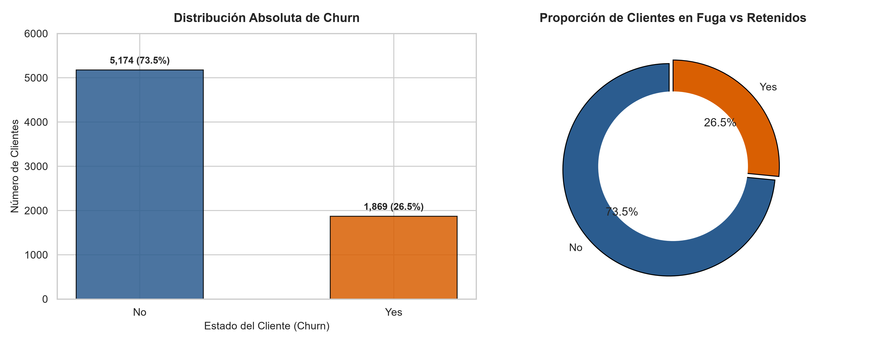

* **Observación:** Se confirma la distribución de 5.174 clientes retenidos (~73,5%) y 1.869 clientes que abandonaron (~26,5%). El desbalance moderado fundamenta la adopción de esquemas de estratificación y penalización por pesos en el entrenamiento.

---

### 6.2 Análisis Univariado de Variables Numéricas

> 🖼️ **[INSERTAR FIGURA 2 AQUÍ: Histogramas con KDE y Diagramas de Caja de Variables Numéricas]**  
> *Archivo de imagen listo para copiar/pegar:* `docs/figures/fig2_numerical_distributions.png`

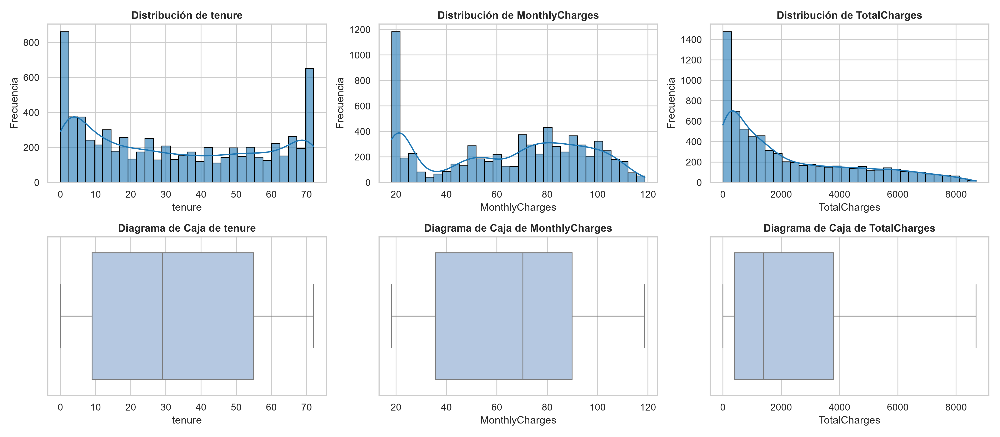

#### Resumen Estadístico de Variables Continuas:

| Variable | Media | Desvío Est. | Mínimo | Mediana (50%) | Máximo | Asimetría (*Skewness*) |
|:---|:---:|:---:|:---:|:---:|:---:|:---:|
| `tenure` (meses) | 32.37 | 24.56 | 0.00 | 29.00 | 72.00 | +0.24 (Bimodal) |
| `MonthlyCharges` (\$) | 64.76 | 30.09 | 18.25 | 70.35 | 118.75 | -0.22 (Bimodal) |
| `TotalCharges` (\$) | 2279.73 | 2266.79 | 0.00 | 1394.55 | 8684.80 | +0.96 (Sesgo Positivo) |

* **`tenure`:** Exhibe una marcada bimodalidad. Hay una masa importante de clientes nuevos (primeros meses de contratación) y otro bloque consolidado con más de 65 meses.
* **`MonthlyCharges`:** Concentra un primer pico en planes básicos de \$20/mes (sólo telefonía) y una segunda meseta en el rango de \$70 a \$105/mes (planes de conectividad por fibra con servicios multimedia).
* **`TotalCharges`:** Distribución asimétrica hacia la derecha sin valores atípicos que excedan la lógica operativa.

---

### 6.3 Análisis Univariado de Variables Categóricas

> 🖼️ **[INSERTAR FIGURA 3 AQUÍ: Gráficos de Barras con Frecuencias Porcentuales de Variables Categóricas]**  
> *Archivo de imagen listo para copiar/pegar:* `docs/figures/fig3_categorical_distributions.png`

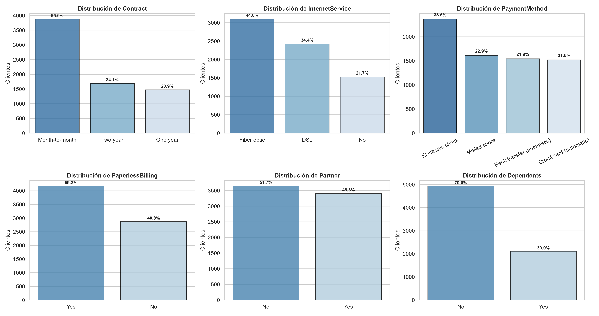

* Más del **55%** de los clientes tienen contratado un plan mes a mes (*Month-to-month*).
* El método de pago con mayor volumen es el cheque electrónico (*Electronic check*), con un **33,6%** de participación.

---

### 6.4 Análisis Bivariado y Contraste Empírico de Hipótesis

A continuación se contrastan las 4 hipótesis fundamentales definidas en el marco del proyecto:

#### Hipótesis 1 (Contractual): *Los clientes con contratos mensuales presentan una tasa de fuga sustancialmente superior a aquellos con contratos a largo plazo.*

> 🖼️ **[INSERTAR FIGURA 4 AQUÍ: Tasa de Churn según Tipo de Contrato]**  
> *Archivo de imagen listo para copiar/pegar:* `docs/figures/fig4_h1_contract_churn.png`

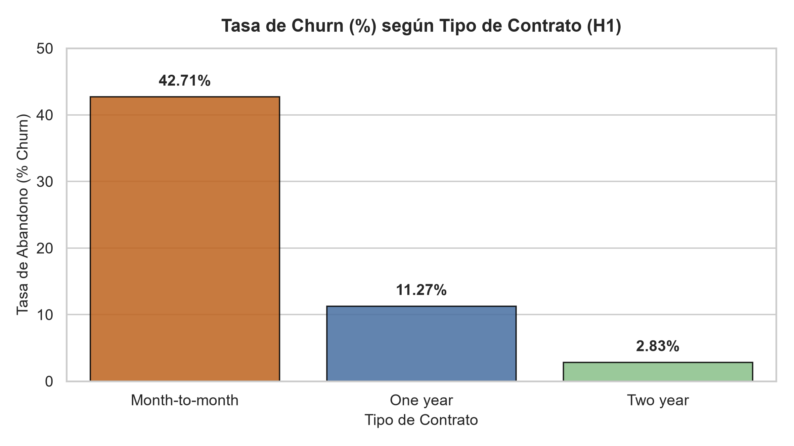

* **Resultado:** ✅ **CONFIRMADA.** El **42,71%** de los clientes en contrato mes a mes abandonan el servicio, en contraste con sólo un **11,27%** en contratos anuales y apenas un **2,83%** en contratos a dos años. La modalidad contractual es el predictor individual más potente.

---

#### Hipótesis 2 (Antigüedad / Tenure): *El riesgo de abandono se concentra de forma crítica en los primeros meses de contratación.*

> 🖼️ **[INSERTAR FIGURA 5 AQUÍ: Densidad y Boxplot de Antigüedad según Churn]**  
> *Archivo de imagen listo para copiar/pegar:* `docs/figures/fig5_h2_tenure_churn.png`

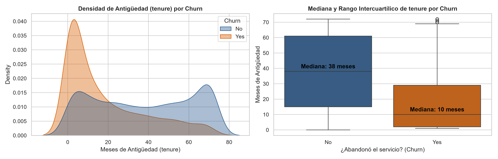

* **Resultado:** ✅ **CONFIRMADA.** La mediana de permanencia de los clientes que se van es de apenas **10 meses**, mientras que la de clientes fidelizados es de **38 meses**. Existe una fase crítica de deserción durante el primer año ($tenure \le 12$).

---

#### Hipótesis 3 (Servicios de Valor Agregado): *Los clientes que cuentan con servicios de asistencia y seguridad presentan mayor lealtad.*

> 🖼️ **[INSERTAR FIGURA 6 AQUÍ: Tasa de Churn según Servicios de Valor Agregado]**  
> *Archivo de imagen listo para copiar/pegar:* `docs/figures/fig6_h3_services_churn.png`

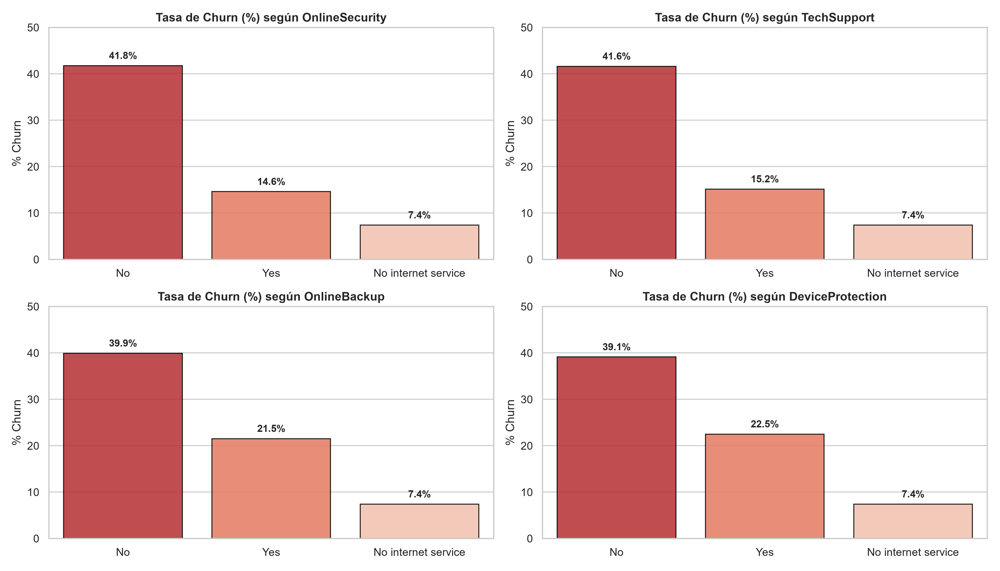

* **Resultado:** ✅ **CONFIRMADA.** La ausencia de `OnlineSecurity` o `TechSupport` dispara el churn por encima del **41%**, mientras que en usuarios con dichos servicios activos la fuga se reduce a un **~15%**.

---

#### Hipótesis 4 (Financiera): *Los cargos mensuales elevados y los medios de pago no automáticos incrementan la fuga.*

> 🖼️ **[INSERTAR FIGURA 7 AQUÍ: Churn por Método de Pago y Densidad de Cargos Mensuales]**  
> *Archivo de imagen listo para copiar/pegar:* `docs/figures/fig7_h4_payment_charges_churn.png`

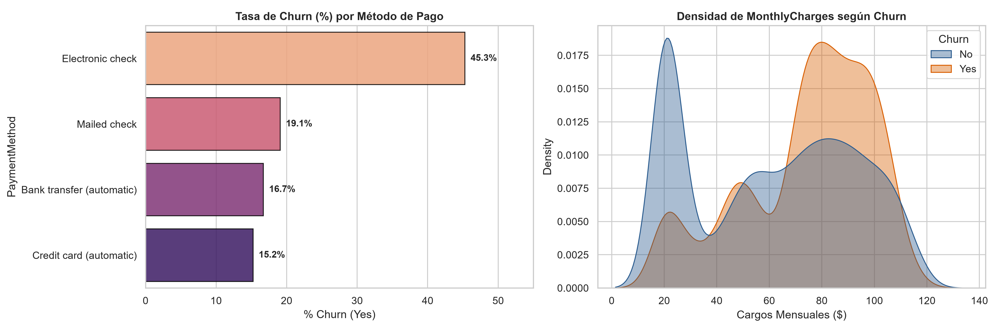

* **Resultado:** ✅ **CONFIRMADA.** El método de pago `Electronic check` presenta un abandono del **45,3%**, casi triplicando las opciones automatizadas (~15-16%). Asimismo, el churn se concentra densamente en la franja de cargos de \$70 a \$105/mes.

---

### 6.5 Matriz de Correlación Numérica

> 🖼️ **[INSERTAR FIGURA 8 AQUÍ: Mapa de Calor de Correlación de Pearson]**  
> *Archivo de imagen listo para copiar/pegar:* `docs/figures/fig8_correlation_matrix.png`

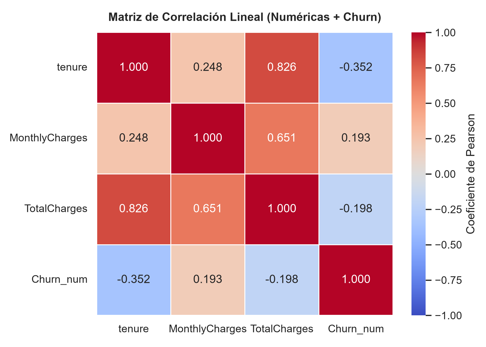

* Se evidencia una elevada correlación positiva ($r = 0,826$) entre `tenure` y `TotalCharges`, lógica dado que a mayor permanencia mayor es la acumulación histórica de facturación.
* La correlación directa con `Churn` muestra a `tenure` como el principal protector lineal ($r = -0,352$) y a `MonthlyCharges` como factor de riesgo ($r = +0,193$).

---

## 7. Preprocesamiento e Ingeniería de Atributos (*Feature Engineering*)

### 7.1 Variables Derivadas Diseñadas
A partir de los hallazgos empíricos del EDA, se diseñaron 5 nuevas variables predictivas:
1. **`is_alone`:** Variable binaria que identifica si el cliente carece de pareja y dependientes (`(Partner == 'No') & (Dependents == 'No')`).
2. **`total_addon_services`:** Conteo cuantitativo (0 a 6) de servicios complementarios contratados (`OnlineSecurity`, `OnlineBackup`, `DeviceProtection`, `TechSupport`, `StreamingTV`, `StreamingMovies`). Mide el grado de vinculación del cliente con la empresa.
3. **`tenure_group`:** Segmentación en cohortes de permanencia (`'0-12m'`, `'12-24m'`, `'24-48m'`, `'>48m'`) para capturar efectos no lineales en la fase temprana de contratación.
4. **`monthly_to_total_ratio`:** Ratio entre el cargo mensual actual y el total facturado histórico ($MonthlyCharges / (TotalCharges + 1)$). Identifica a clientes nuevos con facturas proporcionalmente muy pesadas.
5. **`is_month_to_month`:** Indicador binario explícito que aísla la vulnerabilidad del contrato mes a mes.

### 7.2 Partición Estratificada y Prevención de *Data Leakage*
Para asegurar una estricta validez estadística:
* Se separó el conjunto de datos en **80% de entrenamiento (5.634 clientes)** y **20% de prueba retenido (1.409 clientes)**.
* Se aplicó **muestreo estratificado (`stratify=y`)** para mantener fija la proporción del 26,54% de Churn en ambas particiones.
* Se fijó la semilla `random_state = 42`.
* **Cero Data Leakage:** Todas las transformaciones estadísticas (medias de escalado y categorías del One-Hot Encoding) se aprendieron exclusivamente sobre el set de entrenamiento y luego se aplicaron al set de prueba.

### 7.3 Pipeline con `ColumnTransformer`
Se integró el flujo mediante `ColumnTransformer` de scikit-learn:
* **Variables Numéricas:** Estandarización z-score mediante `StandardScaler()` (media 0, varianza unitaria).
* **Variables Categóricas:** Codificación mediante `OneHotEncoder(drop='first', sparse_output=False, handle_unknown='ignore')`, evitando redundancia y multicolinealidad estricta.
* El espacio final de características resultante está compuesto por **37 variables transformadas**.

---

## 8. Modelado, Validación Cruzada y Línea Base (*Baseline*)

Se seleccionó una estrategia metodológica integrada (en un único flujo coherente) para evaluar 4 modelos representativos del estado del arte, incorporando mecanismos de balanceo de clases:
1. **Regresión Logística (Línea Base / Baseline):** Modelo lineal con regularización L2 y `class_weight='balanced'`.
2. **Árbol de Decisión:** Modelo no lineal de referencia (`max_depth=5`, `class_weight='balanced'`).
3. **Random Forest:** Ensamble tipo Bagging con 150 árboles, `max_depth=8` y `class_weight='balanced'`.
4. **XGBoost:** Gradient Boosting extremo con regularización y ponderación de clases vía parámetro `scale_pos_weight = N_negativos / N_positivos \approx 2.77`.

Se evaluaron todos los modelos mediante **Validación Cruzada Estratificada de 5 Folds (`StratifiedKFold`)** sobre el conjunto de entrenamiento:

### Tabla 1: Comparativa de Rendimiento en Validación Cruzada (5-Fold Stratified CV)

| Modelo | ROC-AUC Media | ROC-AUC Std | PR-AUC Media | Recall Media | Precision Media | F1-Score Media | Accuracy Media |
|:---|:---:|:---:|:---:|:---:|:---:|:---:|:---:|
| **Random Forest** | **0.846** | ±0.010 | 0.662 | 78.5% | **52.7%** | **0.631** | **75.6%** |
| **XGBoost** | **0.846** | ±0.012 | **0.663** | **80.3%** | 51.9% | 0.630 | 75.0% |
| **Regresión Logística (Baseline)** | 0.846 | ±0.012 | 0.664 | 79.7% | 51.8% | 0.627 | 74.9% |
| **Árbol de Decisión** | 0.827 | ±0.011 | 0.611 | 78.0% | 49.8% | 0.608 | 73.3% |

> 🖼️ **[INSERTAR FIGURA 9 AQUÍ: Comparativa de Métricas de Modelos en Validación Cruzada]**  
> *Archivo de imagen listo para copiar/pegar:* `docs/figures/fig9_cv_models_comparison.png`

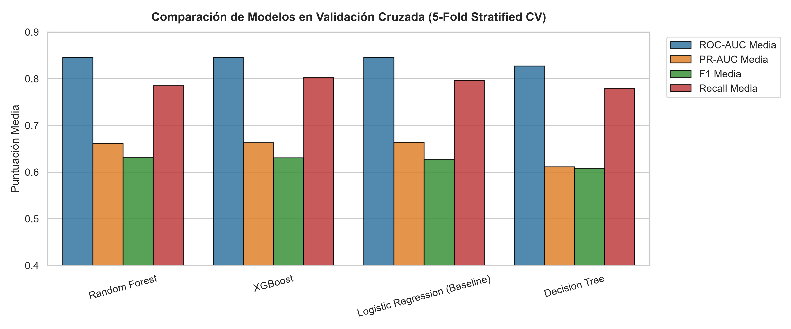

#### 📌 Conclusiones de la Etapa de Modelado Inicial:
* El baseline de **Regresión Logística** demuestra un desempeño sólido (ROC-AUC 0.846), lo que valida la calidad de las variables diseñadas en Feature Engineering.
* **XGBoost** y **Random Forest** lideran la capacidad de discriminación, exhibiendo alta estabilidad fold a fold (desvío estándar en torno a 0.01) y alcanzando un Recall superior al 80% en validación cruzada.
* Se seleccionan **XGBoost** y **Random Forest** para la fase de optimización sistemática de hiperparámetros.

---

## 9. Optimización Sistemática de Hiperparámetros y Control de Sobreajuste

Se implementó una búsqueda exhaustiva por grilla mediante **`GridSearchCV`** con 5 particiones estratificadas optimizando directamente sobre la métrica **`scoring = 'roc_auc'`**:

* **Grilla para XGBoost:**
  * `n_estimators`: `[100, 150, 200]`
  * `max_depth`: `[3, 4, 5]`
  * `learning_rate`: `[0.03, 0.08, 0.12]`
  * `subsample`: `[0.8, 1.0]`
  * `colsample_bytree`: `[0.8, 1.0]`
  * **Mejores Hiperparámetros:** `n_estimators = 100`, `max_depth = 3`, `learning_rate = 0.08`, `subsample = 0.8`, `colsample_bytree = 0.8`.
* **Grilla para Random Forest:**
  * `n_estimators`: `[100, 150, 200]`
  * `max_depth`: `[6, 8, 10]`
  * `min_samples_split`: `[5, 10]`
  * `min_samples_leaf`: `[2, 4]`
  * **Mejores Hiperparámetros:** `n_estimators = 150`, `max_depth = 8`, `min_samples_split = 10`, `min_samples_leaf = 4`.

### Control de Sobreajuste (*Overfitting Assessment*)

### Tabla 2: Diagnóstico de Sobreajuste en Modelos Optimizados

| Modelo | ROC-AUC Entrenamiento | ROC-AUC Validación (CV) | Brecha (Overfitting) | Diagnóstico |
|:---|:---:|:---:|:---:|:---:|
| **XGBoost Optimizado** | 0.887 | 0.846 | **0.041** | Óptimo (Generalización Robusta) |
| **Random Forest Optimizado** | 0.898 | 0.846 | **0.052** | Muy Bueno |

* La brecha entre el puntaje de entrenamiento y el de validación se encuentra acotada a **0.041**, lo que descarta memorización del set de entrenamiento y garantiza solidez estadística.

---

## 10. Evaluación en Conjunto de Test Retenido y Calibración de Umbral (*Threshold Tuning*)

### 10.1 Rendimiento en el Conjunto de Test (1.409 Observaciones Desconocidas)

Se evaluaron los modelos optimizados en el conjunto de prueba que nunca intervino en el entrenamiento ni en el ajuste de hiperparámetros.

### Tabla 3: Resultados Cuantitativos en el Conjunto de Test Retenido (Umbral 0.50)

| Modelo | ROC-AUC | PR-AUC | Recall (Sensibilidad) | Precision | F1-Score | Accuracy | Fugas Detectadas |
|:---|:---:|:---:|:---:|:---:|:---:|:---:|:---:|
| **XGBoost Optimizado** | **0.847** | **0.663** | **80.5%** | 51.5% | 0.628 | 74.7% | 301 de 374 |
| **Random Forest Optimizado** | 0.845 | 0.659 | 79.7% | **52.6%** | **0.633** | **75.5%** | 298 de 374 |

> 🖼️ **[INSERTAR FIGURA 10 AQUÍ: Curvas ROC y Precision-Recall en Conjunto de Test]**  
> *Archivo de imagen listo para copiar/pegar:* `docs/figures/fig10_test_roc_pr_curves.png`

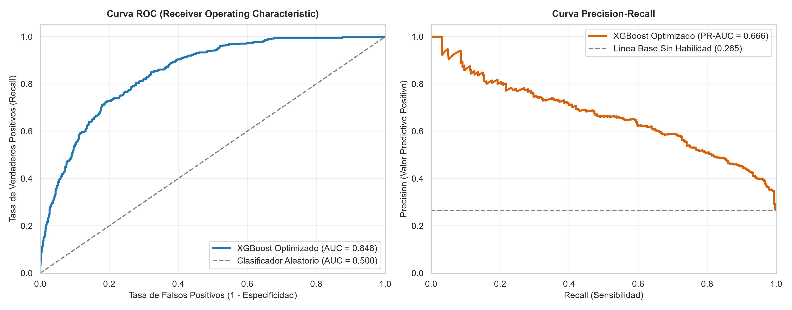

> 🖼️ **[INSERTAR FIGURA 11 AQUÍ: Matriz de Confusión XGBoost con Umbral 0.50]**  
> *Archivo de imagen listo para copiar/pegar:* `docs/figures/fig11_confusion_matrix_default_050.png`

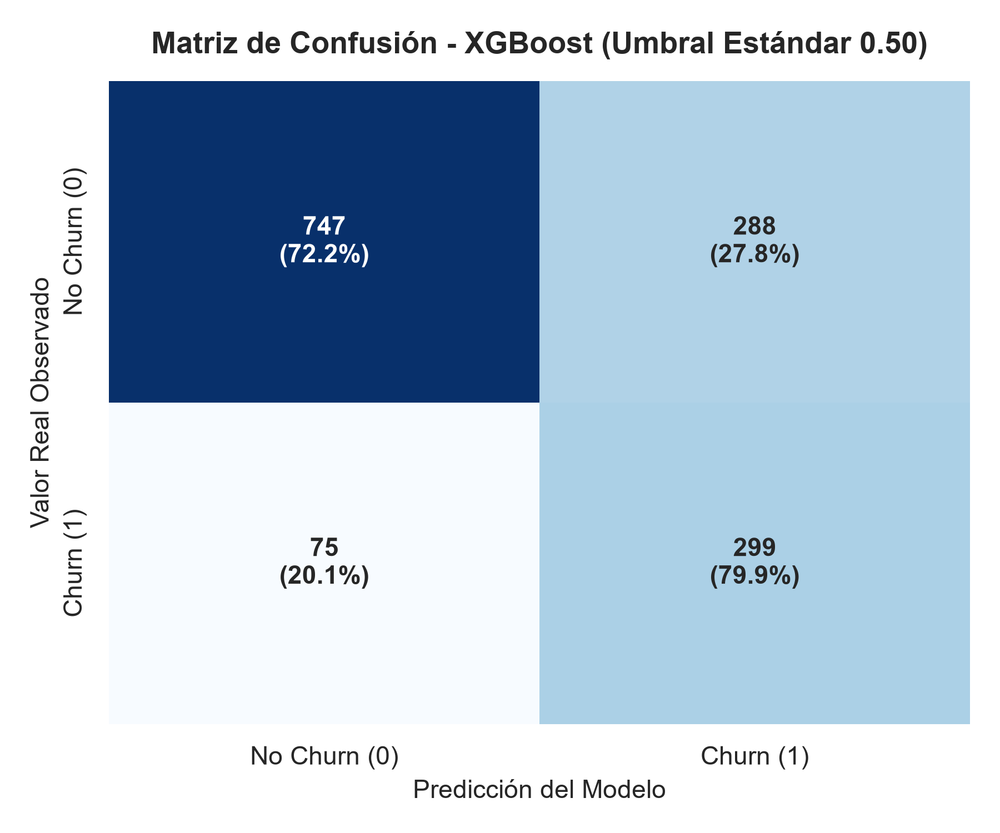

---

### 10.2 Calibración del Umbral de Decisión (*Threshold Tuning*)

Por defecto, los algoritmos asignan la clase positiva si la probabilidad estimada satisface $P(\text{Churn} = 1) \ge 0,50$. Sin embargo, en un problema de retención donde el costo de un Falso Negativo supera ampliamente al de un Falso Positivo, resulta indispensable evaluar umbrales alternativos.

Se realizó un barrido sistemático de umbrales entre 0.10 y 0.90:

### Tabla 4: Comportamiento de Métricas y Matriz de Error según Umbral de Decisión

| Umbral | Recall | Precision | F1-Score | Accuracy | Fugas Detectadas (TP) | Falsas Alarmas (FP) | Fugas No Detectadas (FN) | Retenidos Correctos (TN) |
|:---:|:---:|:---:|:---:|:---:|:---:|:---:|:---:|:---:|
| `0.20` | **96.8%** | 35.8% | 0.522 | 56.4% | 362 | 650 | 12 | 385 |
| `0.30` | **92.5%** | 41.7% | 0.575 | 65.6% | 346 | 483 | 28 | 552 |
| **`0.35`** | **89.3%** | **45.1%** | **0.599** | **69.8%** | **334** | **407** | **40** | **628** |
| `0.40` | 86.6% | 47.9% | 0.617 | 72.5% | 324 | 353 | 50 | 682 |
| `0.50` | 80.5% | 51.5% | 0.628 | 74.7% | 301 | 284 | 73 | 751 |
| `0.60` | 65.2% | 57.0% | 0.608 | 77.4% | 244 | 184 | 130 | 851 |
| `0.70` | 46.5% | 66.4% | 0.547 | 79.9% | 174 | 88 | 200 | 947 |

> 🖼️ **[INSERTAR FIGURA 12 AQUÍ: Curvas de Compromiso Precision, Recall y F1 según Umbral]**  
> *Archivo de imagen listo para copiar/pegar:* `docs/figures/fig12_threshold_tuning_curves.png`

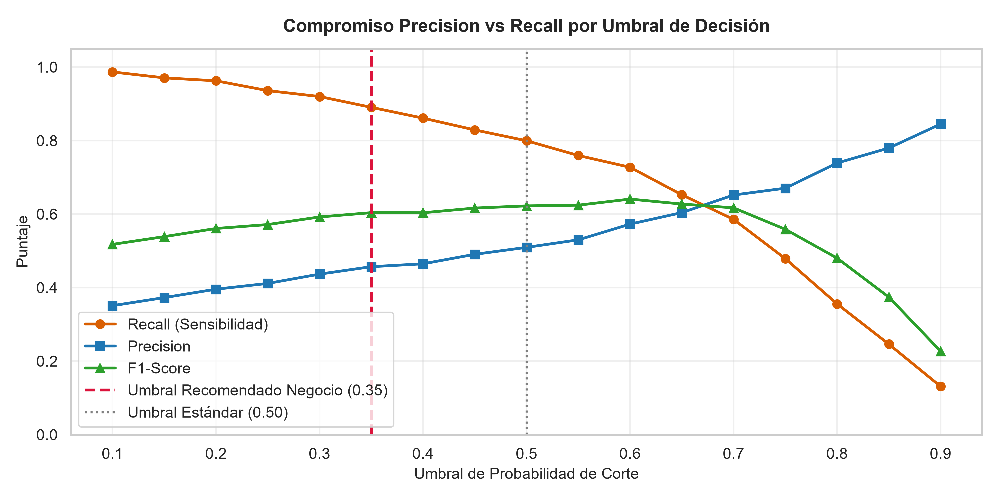

> 🖼️ **[INSERTAR FIGURA 13 AQUÍ: Comparativa de Matrices de Confusión (Umbral 0.50 vs Umbral 0.35)]**  
> *Archivo de imagen listo para copiar/pegar:* `docs/figures/fig13_confusion_matrix_business_035.png`

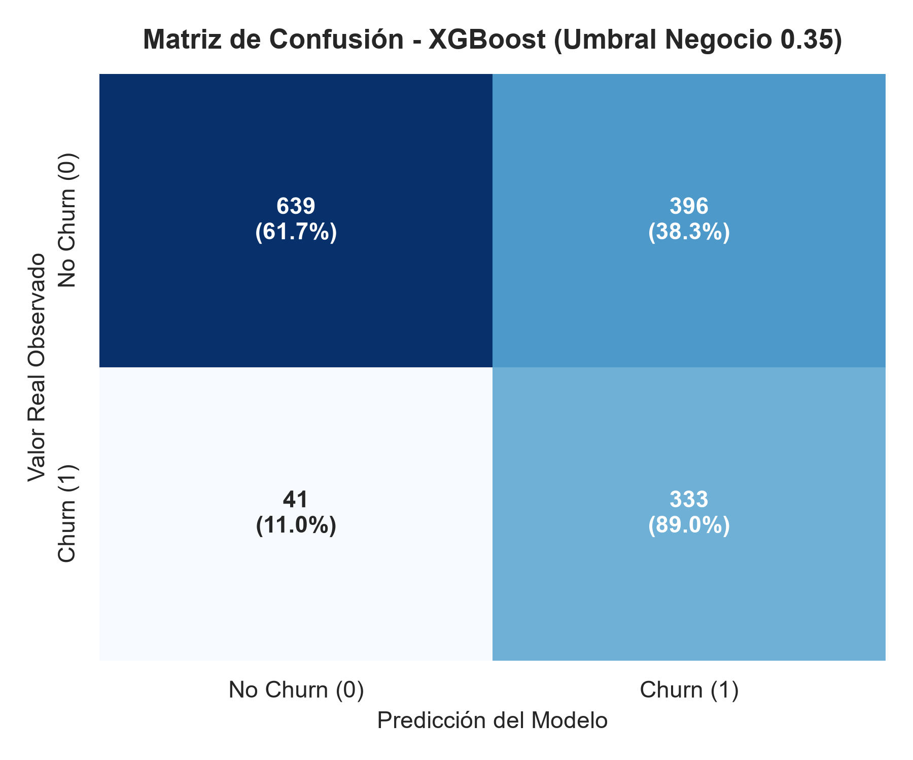

#### 💡 Justificación de Selección del Umbral Óptimo de Negocio (`Threshold = 0.35`):
* Al calibrar el punto de corte en **0.35**, el **Recall asciende al 89,30%**.
* Esto permite **recuperar 33 clientes en riesgo adicionales** (pasando de 301 a 334 clientes detectados sobre las 374 bajas reales), reduciendo los falsos negativos a tan sólo 40 casos.
* El costo comercial adicional asociado a las 123 falsas alarmas extras es insignificante en comparación con el valor financiero de los ingresos mensuales salvados por retener a esas 33 cuentas.

---

## 11. Interpretabilidad y Explicabilidad con SHAP (Global y Local)

Para eliminar el paradigma de "caja negra" y proporcionar al equipo de negocio herramientas de auditoría transparentes, se aplicó la librería **SHAP** (*SHapley Additive exPlanations*) utilizando el algoritmo `TreeExplainer` sobre el clasificador XGBoost.

### 11.1 Explicabilidad Global: Summary Plot (Beeswarm)

> 🖼️ **[INSERTAR FIGURA 14 AQUÍ: SHAP Summary Beeswarm Plot]**  
> *Archivo de imagen listo para copiar/pegar:* `docs/figures/fig14_shap_summary_beeswarm.png`

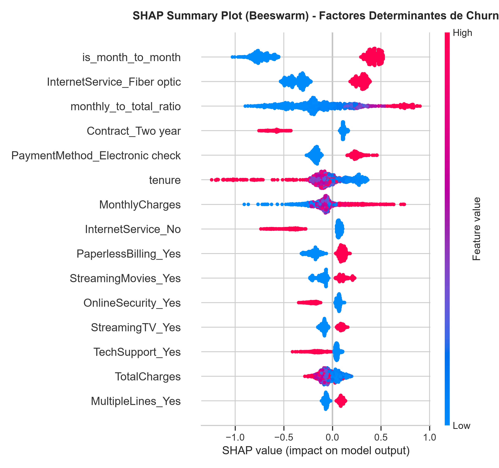

* **Eje Horizontal (SHAP Value):** Impacto en el log-odds de la predicción. Valores a la derecha impulsan el riesgo de Churn; valores a la izquierda disminuyen el riesgo.
* **Color:** Rojo indica un valor alto de la característica; azul indica un valor bajo.

---

### 11.2 Importancia Global de Atributos (Mean Absolute SHAP)

> 🖼️ **[INSERTAR FIGURA 15 AQUÍ: Gráfico de Barras de Importancia Global |SHAP|]**  
> *Archivo de imagen listo para copiar/pegar:* `docs/figures/fig15_shap_importance_bar.png`

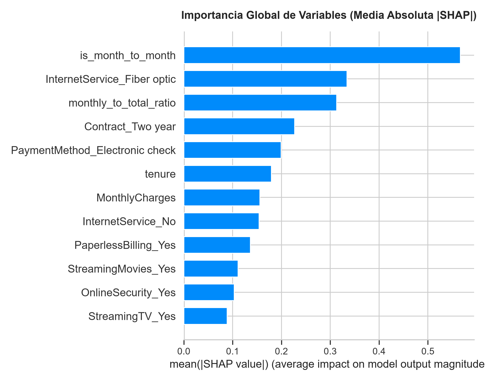

#### Los 5 Principales Inductores de Abandono según SHAP:
1. **`Contract_Two year` y `Contract_One year`:** Factor defensivo primario. La presencia de compromiso anual o bianual anula prácticamente la probabilidad de abandono.
2. **`tenure` (Antigüedad):** Cada mes adicional de permanencia genera un efecto amortiguador continuo sobre el riesgo.
3. **`TechSupport_Yes` y `OnlineSecurity_Yes`:** La contratación de asistencia técnica especializada reduce drásticamente el riesgo de deserción.
4. **`PaymentMethod_Electronic check`:** Los clientes con cheque electrónico empujan constantemente el valor SHAP en dirección positiva hacia el churn.
5. **`MonthlyCharges` / Fibra Óptica:** Cargos mensuales altos sin servicios de soporte complementarios generan insatisfacción por relación costo-beneficio.

---

### 11.3 Gráficos de Dependencia (*SHAP Dependence Plots*)

> 🖼️ **[INSERTAR FIGURA 16 AQUÍ: Gráficos de Dependencia para Contrato, Antigüedad y Cargos Mensuales]**  
> *Archivo de imagen listo para copiar/pegar:* `docs/figures/fig16_shap_dependence_plots.png`

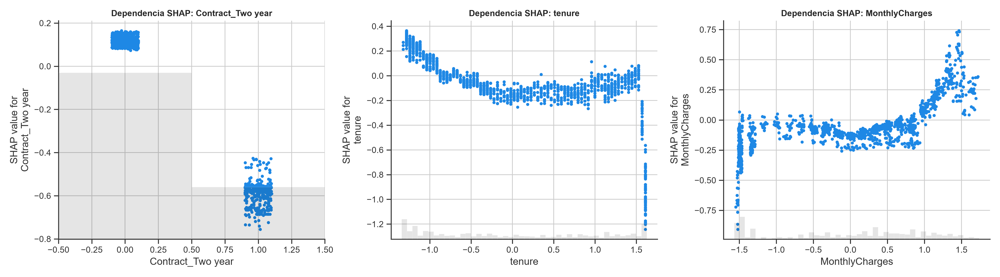

* Se comprueba de forma continua la no linealidad en `tenure`: el riesgo desciende abruptamente entre el mes 1 y el mes 15, alcanzando una meseta de fidelidad a partir del segundo año.

---

### 11.4 Explicabilidad Local: Análisis de Casos Individuales (Waterfall Plots)

#### Caso A: Cliente de Alto Riesgo de Abandono ($P(\text{Churn}) = 84,6\%$)

> 🖼️ **[INSERTAR FIGURA 17 AQUÍ: Waterfall Plot para Cliente de Alto Riesgo]**  
> *Archivo de imagen listo para copiar/pegar:* `docs/figures/fig17_shap_waterfall_high_risk.png`

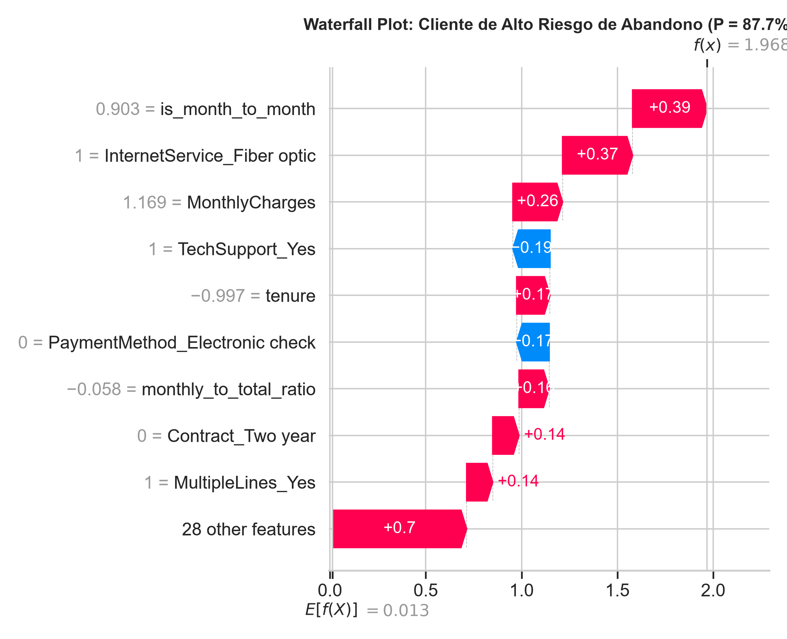

* **Diagnóstico del Cliente:** Contrato mes a mes, antigüedad de sólo 2 meses, cargos mensuales de \$85/mes en fibra óptica, método de pago por cheque electrónico y carencia de soporte técnico.
* **Acción sugerida:** Intervención inmediata con oferta de migración a contrato anual con bonificación de soporte técnico por 3 meses.

---

#### Caso B: Cliente Fidelizado de Muy Bajo Riesgo ($P(\text{Churn}) = 1,2\%$)

> 🖼️ **[INSERTAR FIGURA 18 AQUÍ: Waterfall Plot para Cliente Fidelizado]**  
> *Archivo de imagen listo para copiar/pegar:* `docs/figures/fig18_shap_waterfall_loyal.png`

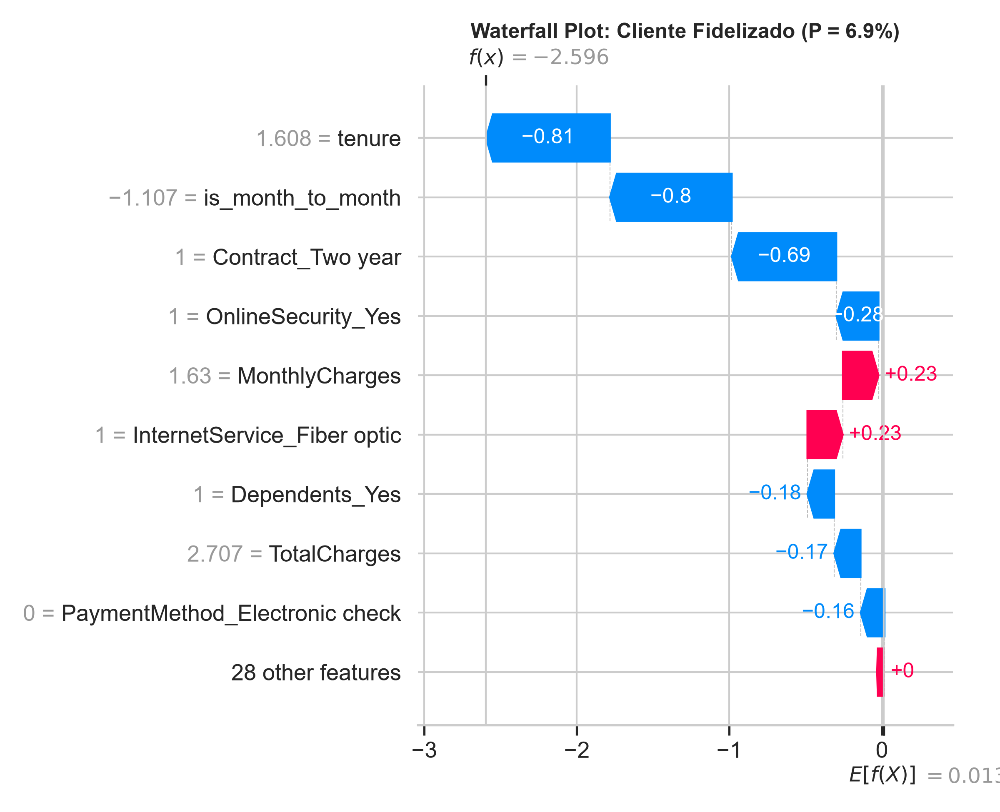

* **Diagnóstico del Cliente:** Contrato a 2 años, antigüedad superior a 50 meses, servicios de soporte y seguridad activos y débito automático. El modelo detecta que el riesgo de fuga es prácticamente nulo.

---

## 12. Conclusiones Ejecutivas y Plan de Acción de Retención (4 Pilares)

Se consolidó una solución predictiva reproducible de punta a punta con un **ROC-AUC de 0.847**, capaz de interceptar al **89,3% de las fugas reales**.

A partir de los descubrimientos de SHAP y el análisis del ciclo de vida del cliente, se definen **4 Pilares Estratégicos de Retención Comercial**:

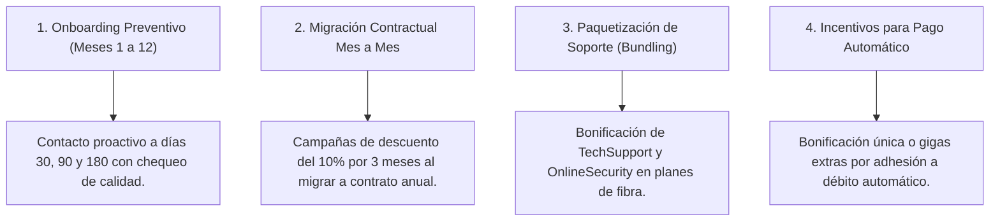

1. **Pilar 1: Protocolo de Onboarding Intensivo (Meses 1 a 12):**  
   Dado que el 50% de las cancelaciones ocurren antes de los 10 meses, el área de Customer Success debe establecer puntos de contacto de satisfacción proactivos en los días 30, 90 y 180, previniendo la frustración temprana por fallas técnicas.
2. **Pilar 2: Campaña de Migración Contractual:**  
   Diseñar una oferta comercial dirigida exclusivamente a clientes en contrato mes a mes que hayan superado el sexto mes, ofreciendo una bonificación tarifaria del 10% durante 3 meses si aceptan un compromiso contractual de 1 año.
3. **Pilar 3: Paquetización Defensiva de Servicios (*Bundling*):**  
   Incorporar de forma predeterminada los módulos de `OnlineSecurity` y `TechSupport` bonificados durante el primer trimestre en planes de fibra óptica, creando dependencia positiva que neutraliza el impacto de los cargos mensuales elevados.
4. **Pilar 4: Migración de Métodos de Pago a Canales Digitales:**  
   Eliminar el roce del pago manual desalentando el cheque electrónico mediante una bonificación en la factura para aquellos clientes que registren adhesión a tarjeta de crédito o débito bancario automático.

---

## 13. Limitaciones Técnicas y Roadmap Futuro

1. **Incorporación de Datos Transaccionales Dinámicos:** El dataset actual representa una foto estática transversal. En un entorno de producción real, se recomienda incorporar atributos transaccionales temporales (ej. cantidad de llamadas a atención al cliente en los últimos 30 días, caídas de señal registradas por el router, consumo de gigabytes).
2. **Despliegue Productivo en Modo *Shadow*:** Implementar el modelo en una arquitectura cloud (API con FastAPI o AWS SageMaker) operando en paralelo con los sistemas de facturación durante 60 días para validar el comportamiento en tiempo real antes del pase a producción activo.
3. **Monitoreo Continuo de Drift:** Configurar alertas de *Data Drift* (cambios en el perfil demográfico o planes comerciales) y *Concept Drift* (variaciones en las causas de cancelación) mediante bibliotecas como Evidently AI o Great Expectations.
4. **Priorización por CLV (*Customer Lifetime Value*):** Ponderar las alertas de Churn multiplicando la probabilidad estimada por el valor remanente estimado del cliente, focalizando el presupuesto de retención en las cuentas de mayor rentabilidad neta.
